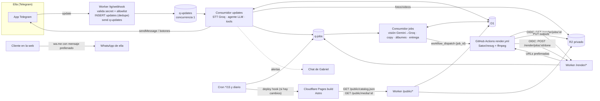

# Veky Companion — Diseño (v1)

> Fecha: 2026-11-17. Entrada: `docs/00-vision-y-decisiones.md` (D1–D11) y los cuatro spikes en `spikes/`.
> Los resultados medidos de los spikes son hechos; lo que no está verificado se marca **[sin verificar]**.
> Los límites gratuitos citados se consultaron el 2026-11-17 en la documentación oficial (URLs en cada sección).
> El plan por etapas está en `docs/03-plan-implementacion.md`.

Convenciones: "ella" es la usuaria (la artesana); "Gabriel" es el admin. La marca pública es **Veky**; el código y el bot usan `veki`.

---

## 1. Arquitectura y flujo de datos

### 1.1 Piezas

| Pieza | Tecnología | Qué hace | Por qué así |
|---|---|---|---|
| `apps/bot` | Cloudflare Worker (TS) | Webhook de Telegram, consumidores de colas, cron, API pública de solo lectura del catálogo, endpoints para el render | D1, D4. El webhook solo valida y encola: 10 ms de CPU por pedido en el plan Free |
| Cola `q-updates` | Cloudflare Queues | Procesa cada update de Telegram en orden (concurrencia 1) | Telegram reintenta si el webhook tarda; el trabajo (STT + LLM) no entra en 10 ms de CPU ni conviene en `waitUntil` (máx. 30 s) |
| Cola `q-jobs` | Cloudflare Queues | Trabajos lentos: visión, textos, entrega de contenido, agrupación de álbumes | Spike 4: Gemini tardó hasta 378 s con reintentos. Los reintentos usan `retry({delaySeconds})`, sin dormir dentro del consumidor |
| D1 `veki` | Cloudflare D1 | Catálogo, agenda, estado de conversación, acciones pendientes, trabajos, recordatorios, log | D4 |
| R2 `veki-media` | Cloudflare R2 (privado) | Fotos y videos originales, renders, backups | D4. Bucket privado: se lee vía Worker o URL prefirmada |
| `apps/render` + `render.yml` | Node + Satori/resvg + ffmpeg en GitHub Actions | Flyers, carruseles y reels | D10. Spike 3: el flyer cuesta 145–330 ms de CPU (15–35× el límite de Workers) |
| `apps/web` | Astro estático en Cloudflare Pages | Catálogo, producto, agenda, CTA de WhatsApp | D3, D5 |
| Proveedores de IA | Groq (chat, STT, visión de respaldo), Gemini (visión), Workers AI (STT de respaldo) | Ver §4.6 | D9, D11 |

### 1.2 Diagrama



### 1.3 Flujo típico: alta de producto por foto y voz

1. Ella manda 3 fotos (álbum) y una nota de voz: "Esta es la riñonera girasol, sale doce mil quinientos, tengo dos".
2. Webhook (por cada update): verifica `X-Telegram-Bot-Api-Secret-Token`, verifica `chat.id` en la allowlist, `INSERT OR IGNORE INTO updates(update_id…)`; si ya existía responde 200 y termina (Telegram reintenta). Si es nuevo, `q-updates.send({type:"update", update_id, update})` (el cuerpo del update viaja en el mensaje transitorio de la cola porque la tabla `updates` no guarda payload) y responde 200.
3. Consumidor (`q-updates`, lote 1, concurrencia 1): fotos con `media_group_id` → se guardan en `media` (estado `inbox`) y se registra el grupo en `inbox_groups`; se encola en `q-jobs` un `album.flush` con `delaySeconds: 3` (§2.3). Voz → descarga de Telegram → Groq Whisper → texto → agente.
4. El agente llama `actualizar_borrador({nombre, precio, stock})`. El código calcula qué falta (`categoria`): el bot pregunta **una sola cosa**.
5. Con el borrador completo, el agente llama `crear_producto` → se crea una `pending_action` con vista previa y botones **Sí / Cambiar / Cancelar**.
6. "Sí" → ejecución idempotente, `event_log`, `site_state.dirty_since = now`. El bot responde "¡Listo! En un ratito aparece en la web" con botón **Deshacer**.
7. Cron `*/15`: si hay cambios y se respeta el presupuesto de builds, llama al deploy hook de Pages. Astro pide `/public/catalog.json`, baja las imágenes y publica.

---

## 2. Modelo de datos (D1)

### 2.1 Límites que condicionan el diseño (plan Free)

| Límite | Valor | Fuente | Consecuencia |
|---|---|---|---|
| CPU por pedido HTTP o cron | 10 ms | [Workers limits](https://developers.cloudflare.com/workers/platform/limits/) | Webhook y cron solo validan, escriben 1–2 filas y encolan |
| Subrequests por invocación | 50 | ídem | Agente con tope de 4 llamadas al LLM por update; presupuesto en §4.6 |
| Pedidos/día | 100.000 | ídem | Uso esperado < 2.000/día |
| `waitUntil` después de la respuesta | hasta 30 s | ídem | No se usa para IA; todo va a colas |
| Cron Triggers por cuenta | 5 | ídem | Se usan 2 (§3.7) |
| Consultas D1 por invocación | 50 | [D1 limits](https://developers.cloudflare.com/d1/platform/limits/) | Usar `db.batch()`; tope de diseño: 30 consultas por invocación |
| Tamaño máximo por base | 500 MB (5 GB en total por cuenta) | [D1 limits](https://developers.cloudflare.com/d1/platform/limits/), [D1 pricing](https://developers.cloudflare.com/d1/platform/pricing/) | Corrige `00` §6 ("5 GB" es el total). Sobra: el catálogo pesa KB. Nunca guardar binarios ni base64 en D1 |
| Filas leídas / escritas por día | 5 M / 100.000 | [D1 pricing](https://developers.cloudflare.com/d1/platform/pricing/) | Uso estimado < 5.000 escrituras/día |
| Parámetros por consulta | 100 | [D1 limits](https://developers.cloudflare.com/d1/platform/limits/) | Inserts masivos en lotes |
| Time Travel | 7 días | ídem | Más backup propio a R2 (§6.4) |
| Queues | 10.000 operaciones/día, retención 24 h | [Queues pricing](https://developers.cloudflare.com/queues/platform/pricing/) | ~3 operaciones por mensaje → ~3.300 mensajes/día. Uso esperado < 500 |
| Consumidor de cola | 15 min de reloj; `delaySeconds` hasta 24 h; 100 reintentos | [Queues limits](https://developers.cloudflare.com/queues/platform/limits/) | La página dice 30 s de CPU por defecto también en Free **[sin verificar en una cuenta Free]**. El diseño apunta a < 10 ms de CPU igual |
| Durable Objects | Disponibles en Free (solo SQLite) | [DO pricing](https://developers.cloudflare.com/durable-objects/platform/pricing/) | No hacen falta (§2.3); quedan como alternativa |

### 2.2 Esquema

Claves: `TEXT` con ULID (`01J…`) generado en código, ordenable por fecha. Tiempos: `INTEGER` en ms epoch UTC. Precios: `INTEGER` en pesos (sin decimales). JSON en columnas `TEXT` validadas con zod en `packages/core`.

```sql
-- Catálogo
CREATE TABLE products (
  id TEXT PRIMARY KEY,
  slug TEXT NOT NULL UNIQUE,              -- "rinonera-girasol"
  name TEXT NOT NULL,
  category TEXT NOT NULL,                 -- valor de settings.categories
  description TEXT,                       -- en tono Veky, confirmada por ella
  price_ars INTEGER,                      -- NULL = "consultar"
  status TEXT NOT NULL DEFAULT 'active',  -- draft|active|hidden|archived
  featured INTEGER NOT NULL DEFAULT 0,
  created_at INTEGER NOT NULL, updated_at INTEGER NOT NULL
);
CREATE INDEX idx_products_status ON products(status, updated_at);

CREATE TABLE variants (
  id TEXT PRIMARY KEY,
  product_id TEXT NOT NULL REFERENCES products(id),
  design TEXT NOT NULL DEFAULT '',        -- "girasol"
  size TEXT NOT NULL DEFAULT '',          -- "chica"
  color TEXT NOT NULL DEFAULT '',         -- "lila"
  price_ars INTEGER,                      -- NULL = precio del producto
  stock INTEGER,                          -- NULL = no sabe / a pedido
  status TEXT NOT NULL DEFAULT 'active',  -- active|archived
  updated_at INTEGER NOT NULL,
  UNIQUE (product_id, design, size, color)
);
CREATE INDEX idx_variants_product ON variants(product_id);

CREATE TABLE media (
  id TEXT PRIMARY KEY,
  r2_key TEXT NOT NULL UNIQUE,            -- "orig/2026/11/<id>.jpg"
  kind TEXT NOT NULL,                     -- photo|video|render_flyer|render_reel|render_carousel
  mime TEXT NOT NULL, bytes INTEGER, width INTEGER, height INTEGER, duration_s REAL,
  tg_file_unique_id TEXT UNIQUE,          -- dedupe si reenvía la misma foto
  tg_small_file_id TEXT,                  -- tamaño ~800 px de Telegram, para visión
  product_id TEXT REFERENCES products(id),
  variant_id TEXT REFERENCES variants(id),
  position INTEGER,                       -- orden en la web; 0 = portada
  alt_text TEXT,
  status TEXT NOT NULL DEFAULT 'inbox',   -- inbox|attached|discarded
  created_at INTEGER NOT NULL,
  media_group_id TEXT                     -- álbum de Telegram al que pertenece (migración 0002); NULL = suelta
);
CREATE INDEX idx_media_product ON media(product_id, position);
CREATE INDEX idx_media_status ON media(status, created_at);
CREATE INDEX idx_media_group ON media(media_group_id);

-- Agenda
CREATE TABLE fairs (
  id TEXT PRIMARY KEY,
  name TEXT NOT NULL, place TEXT NOT NULL, address TEXT, maps_url TEXT,
  starts_at INTEGER NOT NULL, ends_at INTEGER NOT NULL,
  status TEXT NOT NULL DEFAULT 'confirmed', -- confirmed|cancelled
  public INTEGER NOT NULL DEFAULT 1,
  created_at INTEGER NOT NULL, updated_at INTEGER NOT NULL
);
CREATE INDEX idx_fairs_start ON fairs(starts_at);

-- Telegram y conversación
CREATE TABLE updates (                    -- idempotencia del webhook; purga a 14 días
  update_id INTEGER PRIMARY KEY,
  chat_id INTEGER NOT NULL, kind TEXT NOT NULL,
  status TEXT NOT NULL DEFAULT 'queued',  -- queued|done|failed
  received_at INTEGER NOT NULL, processed_at INTEGER
);

CREATE TABLE inbox_groups (               -- agrupación de álbumes (§2.3)
  media_group_id TEXT PRIMARY KEY,
  chat_id INTEGER NOT NULL,
  item_count INTEGER NOT NULL,
  first_at INTEGER NOT NULL, last_at INTEGER NOT NULL,
  status TEXT NOT NULL DEFAULT 'open'     -- open|flushed
);

CREATE TABLE conversations (
  chat_id INTEGER PRIMARY KEY,
  role TEXT NOT NULL,                     -- owner|admin
  state TEXT NOT NULL DEFAULT '{}',       -- JSON: borrador, pregunta pendiente, contador de malentendidos
  history TEXT NOT NULL DEFAULT '[]',     -- JSON: últimos 12 turnos, recortado
  last_user_msg_at INTEGER,
  version INTEGER NOT NULL DEFAULT 0,     -- bloqueo optimista
  updated_at INTEGER NOT NULL
);

CREATE TABLE pending_actions (
  id TEXT PRIMARY KEY,                    -- va en callback_data: "pa:<id>:yes|chg|no"
  chat_id INTEGER NOT NULL,
  tool TEXT NOT NULL, args TEXT NOT NULL, -- JSON validado
  preview TEXT NOT NULL,
  status TEXT NOT NULL DEFAULT 'pending', -- pending|executed|cancelled|expired|undone
  inverse TEXT,                           -- JSON para deshacer, se llena al ejecutar
  tg_message_id INTEGER,
  created_at INTEGER NOT NULL, expires_at INTEGER NOT NULL, executed_at INTEGER
);
CREATE INDEX idx_pa_chat ON pending_actions(chat_id, status, created_at);

-- Contenido
CREATE TABLE content_jobs (
  id TEXT PRIMARY KEY,
  kind TEXT NOT NULL,                     -- flyer|carousel|reel
  template TEXT NOT NULL,                 -- producto|feria|novedad
  product_id TEXT, fair_id TEXT,
  input TEXT NOT NULL,                    -- JSON: media_ids, textos confirmados
  status TEXT NOT NULL,                   -- ranking|awaiting_choice|writing|awaiting_copy_ok|rendering|delivering|delivered|failed|cancelled
  attempts INTEGER NOT NULL DEFAULT 0,
  provider TEXT, gh_run_id TEXT, error TEXT,
  output TEXT,                            -- JSON: r2 keys
  created_at INTEGER NOT NULL, updated_at INTEGER NOT NULL
);
CREATE INDEX idx_jobs_status ON content_jobs(status, updated_at);

-- Proactividad
CREATE TABLE nudges (
  id TEXT PRIMARY KEY,
  type TEXT NOT NULL,                     -- ver §3.6
  ref_id TEXT,                            -- fair_id, product_id…
  due_at INTEGER NOT NULL,
  status TEXT NOT NULL DEFAULT 'scheduled', -- scheduled|sent|answered|ignored|snoozed|skipped|cancelled
  sent_at INTEGER, answered_at INTEGER, tg_message_id INTEGER,
  UNIQUE (type, ref_id, due_at)
);
CREATE INDEX idx_nudges_due ON nudges(status, due_at);

CREATE TABLE nudge_policy (
  type TEXT PRIMARY KEY,
  enabled INTEGER NOT NULL DEFAULT 1,
  ignored_streak INTEGER NOT NULL DEFAULT 0,
  paused_until INTEGER
);

-- Operación
CREATE TABLE event_log (
  id TEXT PRIMARY KEY, ts INTEGER NOT NULL,
  actor TEXT NOT NULL,                    -- owner|admin|bot|cron|render
  type TEXT NOT NULL,                     -- "product.created", "provider.fallback", "error"…
  severity TEXT NOT NULL DEFAULT 'info',  -- info|warn|error
  entity TEXT, entity_id TEXT,
  data TEXT                               -- JSON sin datos personales ni transcripciones
);
CREATE INDEX idx_event_ts ON event_log(ts);
CREATE INDEX idx_event_entity ON event_log(entity, entity_id, ts);

CREATE TABLE provider_state (            -- circuit breaker
  provider_model TEXT PRIMARY KEY,        -- "gemini:gemini-3.5-flash-lite"
  consecutive_failures INTEGER NOT NULL DEFAULT 0,
  cooldown_until INTEGER
);
CREATE TABLE provider_usage (
  day TEXT NOT NULL, provider_model TEXT NOT NULL,
  requests INTEGER NOT NULL DEFAULT 0, tokens_in INTEGER NOT NULL DEFAULT 0,
  tokens_out INTEGER NOT NULL DEFAULT 0, audio_s INTEGER NOT NULL DEFAULT 0,
  errors INTEGER NOT NULL DEFAULT 0,
  PRIMARY KEY (day, provider_model)
);

CREATE TABLE site_state (                 -- una sola fila, id = 1
  id INTEGER PRIMARY KEY CHECK (id = 1),
  dirty_since INTEGER, last_build_at INTEGER,
  builds_day TEXT, builds_today INTEGER NOT NULL DEFAULT 0
);

CREATE TABLE settings (key TEXT PRIMARY KEY, value TEXT NOT NULL); -- JSON
```

`settings` guarda lo configurable sin desplegar: ids de modelos por capa (D11), categorías, horario de silencio, número de WhatsApp público, tope de builds diarios, cadencias de recordatorios.

### 2.3 Agrupación de álbumes (problema del spike de Telegram)

El spike agrupaba con un `setTimeout` en memoria (`spikes/telegram/src/handlers.ts`); en Workers los isolates no comparten memoria. Solución solo con D1 + Queues, sin Durable Objects:

1. Por cada foto/video con `media_group_id`: `INSERT INTO inbox_groups … ON CONFLICT(media_group_id) DO UPDATE SET item_count = item_count + 1, last_at = :now`, más la fila en `media` (`status='inbox'`), en un solo `db.batch()`.
2. Encolar en `q-jobs` `{type:'album.flush', gid}` con `delaySeconds: 3`.
3. El consumidor ejecuta `UPDATE inbox_groups SET status='flushed' WHERE media_group_id=:gid AND status='open' AND last_at <= :now - 2000`. Si `changes = 1`, este mensaje "ganó" y entrega el álbum al agente como un solo evento. Si `changes = 0` y el grupo sigue `open`, `retry({delaySeconds: 2})`; si ya está `flushed`, ack sin hacer nada.

Cada mensaje del álbum genera un flush; solo uno gana gracias al `UPDATE` condicional (atómico en SQLite). Costo: ~4 escrituras por foto. La ventana de 2 s es la del spike (`ALBUM_DEBOUNCE_MS`). La granularidad mínima de `delaySeconds` es 1 s, así que la respuesta llega 3–5 s después de la última foto: aceptable.

La pertenencia de cada foto a su álbum vive en `media.media_group_id` (migración `0002`). Los álbumes creados antes de esa migración guardaron la pertenencia como filas de `event_log` de tipo `media.group_member`; el flush las sigue leyendo (sin duplicar ids) para esos grupos.

Como `q-updates` corre con concurrencia 1 (`max_concurrency = 1`, [consumer concurrency](https://developers.cloudflare.com/queues/configuration/consumer-concurrency/)), los updates de ella se procesan en orden y `conversations` no tiene escrituras concurrentes del mismo chat. Igual se usa `version` (bloqueo optimista) porque `q-jobs` también escribe estado al entregar resultados.

### 2.4 Migraciones

- `wrangler d1 migrations` con archivos `migrations/NNNN_descripcion.sql`, solo hacia adelante. Nunca se edita una migración ya aplicada.
- Orden: `--local` (tests) → backup a R2 (§6.4) → `--remote`. Un cambio destructivo (borrar columna) se hace en dos migraciones separadas por un release.
- Los tipos de fila y los schemas zod viven en `packages/core/src/db/` y un test compara las columnas del schema con `PRAGMA table_info` en la base local.

### 2.5 Retención y minimización

- `updates`: 14 días. `event_log`: 180 días. `conversations.history`: 12 turnos.
- Audios: se transcriben desde Telegram y **no** se guardan en R2. Los textos transcriptos solo quedan en `history` (recortado).
- Videos: se guardan solo si se usan en un reel; los `inbox` sin usar se borran a los 30 días.
- `event_log.data` nunca lleva transcripciones, textos libres de ella ni números de teléfono.

---

## 3. Diseño de la conversación

### 3.1 Principios operativos

1. **Voz primero.** Toda nota de voz se transcribe (Groq `whisper-large-v3`, D9; ~450 ms medidos) y entra al agente como texto. Se pide `response_format=verbose_json` para tener `avg_logprob`/`no_speech_prob` por segmento **[sin verificar en Groq]**; si la confianza es baja o hay números de dinero, la vista previa los muestra explícitos ("Entendí $12.500").
2. **Una pregunta por vez.** El agente solo habla con la herramienta `responder`, que admite un texto (≤ 350 caracteres) y hasta 6 botones. El código rechaza y pide regenerar una vez si hay más de un `?`.
3. **Qué falta lo decide el código, no el modelo.** El borrador (`state.draft`) tiene campos requeridos por tipo (producto: `name`, `price_ars` o "consultar", `category`, ≥ 1 foto). `nextMissingField(draft)` devuelve el siguiente y el prompt le dice al LLM qué preguntar. Un modelo barato no decide el orden.
4. **Toda escritura se confirma.** Las herramientas de escritura no escriben: crean una `pending_action` con vista previa y botones **Sí / Cambiar / Cancelar** (principio 3).
5. **Todo se puede deshacer.** Cada acción ejecutada guarda `inverse` y el mensaje de éxito trae **Deshacer** (válido 24 h). Ella también puede decir "deshacé lo último".
6. **Idempotencia.** `updates.update_id` evita reprocesar reintentos de Telegram. `callback_data = "pa:<id>:yes"` y la ejecución hace `UPDATE pending_actions SET status='executed' WHERE id=? AND status='pending'`: un doble toque no duplica. Los `INSERT` usan ids generados al crear la `pending_action`, no al ejecutarla.

### 3.2 Tono

- Español rioplatense con "vos" ("mandame", "¿querés?", "dale"). Cálido, alegre, creativo, breve. Máximo un emoji por mensaje. Nunca tecnicismos ("base de datos", "error 503", "webhook").
- El bot se llama **Veki** en el chat; la marca pública es **Veky**.
- Los textos fijos (errores, confirmaciones, recordatorios) viven en `packages/core/src/copy/es-AR.ts`, no los inventa el LLM. Ejemplos tomados del spike: "¡Qué lindas fotos! Recibí 3 fotos.", "Ups, algo salió mal de mi lado. ¿Probás de nuevo? 🙏".

### 3.3 Agente con herramientas

- Modelo: Groq `openai/gpt-oss-120b` (`00` §5) con tool calling; respaldo según §4.6. Temperatura 0,3.
- Ciclo por update: hasta **4** llamadas al LLM (tope de subrequests, §2.1). Si no termina, responde con el texto fijo `copy.noEntendi` y suma 1 a `state.misunderstandings`.
- Contexto enviado: system prompt (rol, tono, reglas), `state` (borrador, pregunta pendiente), resumen del catálogo (solo `id`, `name`, variantes; ≤ 50 productos ≈ 2 K tokens) y los últimos 12 turnos.
- Las herramientas se definen una sola vez con zod en `packages/core/src/tools/` y se convierten a JSON Schema para el proveedor.

| Herramienta | Tipo | Parámetros (zod, resumido) | Efecto |
|---|---|---|---|
| `responder` | habla | `{texto: string≤350, botones?: {etiqueta≤24, valor}[]≤6}` | Único canal de salida al chat |
| `buscar_productos` | lectura | `{consulta: string}` | Coincidencias por nombre/diseño/color (LIKE + normalización sin tildes) |
| `ver_producto` | lectura | `{producto_id}` | Ficha con variantes, stock y fotos |
| `ver_agenda` | lectura | `{desde?: fecha, hasta?: fecha}` | Ferias del rango (default: próximos 30 días) |
| `ver_contenido` | lectura | `{}` | Estado de `content_jobs` abiertos |
| `actualizar_borrador` | borrador | `{tipo: 'producto'|'feria', campos: Partial<…>, media_ids?: string[]}` | Solo `state.draft`; no toca catálogo; no confirma |
| `crear_producto` | escritura | `{}` (usa el borrador completo) | Producto + variantes + fotos adjuntas |
| `editar_producto` | escritura | `{producto_id, cambios: {name?, price_ars?, description?, category?, status?: 'active'|'hidden'}}` | |
| `editar_variantes` | escritura | `{producto_id, agregar?: Variante[], archivar?: variante_id[]}` | |
| `cambiar_stock` | escritura | `{variante_id, delta?: int, fijar?: int≥0, motivo: 'venta'|'reposicion'|'ajuste'}` | Si el producto tiene >1 variante y no está claro cuál, se pregunta con botones |
| `agregar_fotos` | escritura | `{producto_id, media_ids: string[], portada?: media_id}` | |
| `crear_feria` / `editar_feria` / `cancelar_feria` | escritura | `{nombre, lugar, direccion?, inicio, fin}` / `{feria_id, cambios}` / `{feria_id}` | Fechas en `America/Argentina/Buenos_Aires` (UTC-3, sin horario de verano) |
| `pedir_contenido` | escritura | `{tipo: 'flyer'|'carrusel'|'reel', plantilla: 'producto'|'feria'|'novedad', producto_id?, feria_id?, media_ids?}` | Crea `content_job` (§4) |
| `posponer_aviso` | escritura | `{tipo_aviso, hasta: 'en_3h'|'manana'|'nunca'}` | §3.6 |
| `deshacer` | escritura | `{accion_id?}` (default: la última ejecutada <24 h) | Aplica `inverse`; también pide confirmación |

`posponer_aviso` y `deshacer` también se disparan desde botones sin pasar por el LLM.

Vista previa de ejemplo (texto fijo con datos):

```
Te queda así 👇
🧵 Riñonera Girasol — $12.500
Categoría: riñoneras · Stock: 2
Fotos: 3 (portada: la primera)
[Sí] [Cambiar] [Cancelar]
```

"Cambiar" → `state.awaiting = {kind:'edit', pending_action_id}` y el bot pregunta "¿Qué le cambio?". La respuesta vuelve al agente con ese contexto y genera una nueva `pending_action` (la anterior queda `cancelled`). Las `pending_actions` vencen a las 24 h (los botones responden "Eso ya venció, ¿lo armamos de nuevo?").

### 3.4 Malentendidos y errores

| Situación | Respuesta |
|---|---|
| El LLM no logra una acción válida en 4 llamadas | `copy.noEntendi` ("Perdón, no te entendí. ¿Me lo decís de otra forma?") |
| 2 malentendidos seguidos | Botones de atajo: **Cargar producto / Vendí algo / Nueva feria / Pedir flyer**, y aviso a Gabriel con el `update_id` (sin el texto) |
| Proveedor de chat caído (todas las cadenas) | "Estoy un poquito lenta, te respondo en un ratito 🙏"; el update vuelve a la cola con `retry({delaySeconds: 60})` hasta 5 veces; luego alerta a Gabriel |
| STT falla | Fallback Workers AI Whisper **[sin verificar en cuenta Free]**; si también falla: "No pude escuchar el audio, ¿me lo mandás de nuevo o me lo escribís?" |
| Video > 20 MB | Mensaje del spike: pedir un clip de ~10 s ([getFile](https://core.telegram.org/bots/api#getfile), tope 20 MB) |
| Sticker, ubicación, etc. | "Por ahora entiendo fotos, audios, videos cortitos y texto 🙂" |
| Fotos sin contexto | "¡Qué lindas! ¿Es un producto nuevo o son para uno que ya tenés?" (botones: **Nuevo** / **Ya lo tengo**) |
| Excepción no controlada | `bot.catch` igual que el spike + `event_log` severidad `error` + alerta a Gabriel |

### 3.5 Acceso

- Allowlist en `ALLOWED_CHAT_IDS` (var del Worker): su chat (`role=owner`) y el de Gabriel (`role=admin`). Cualquier otro chat: se registra `event_log` `access.denied` (sin contenido) y no se responde.
- El chat de admin usa el mismo agente más comandos `/estado`, `/log`, `/deshacer <id>`, `/reconstruir`, `/pausa` (§6.2).

### 3.6 Proactividad

El bot inicia conversaciones (principio 5; el spike confirmó que puede escribir primero). Todo pasa por la tabla `nudges` y un despachador en el cron `*/15`.

**Catálogo**

| Tipo | Disparo | Cuándo | Mensaje (resumen) | Botones |
|---|---|---|---|---|
| `feria_previa` | Feria confirmada | Día anterior 18:00 | "Mañana estás en {feria}. ¿Te armo un flyer para avisar?" | Sí, dale / Ya tengo / Más tarde |
| `feria_posterior` | Feria terminada | Día siguiente 11:00 | "¿Cómo te fue en {feria}? Contame qué vendiste así actualizo el stock 🎙️" | Te mando audio / No vendí / Más tarde |
| `resumen_semanal` | Fijo | Lunes 10:00 | Productos activos, stock bajo (≤1), ferias de la semana, contenido entregado. Termina con **una** sugerencia | Ver detalle / Listo |
| `agenda_vacia` | Sin ferias en 14 días | Martes 11:00, cada 2 semanas | "¿Tenés alguna feria en las próximas semanas? Así la pongo en la web" | Sí / No por ahora |
| `producto_incompleto` | Producto sin foto o sin precio | Dentro del resumen semanal, no aparte | — | — |
| `inactividad` | 7 días sin mensajes de ella | 11:00 | Saludo + una idea fácil ("¿Me mandás una foto de lo último que cosiste?") | Dale / Más tarde |
| `contenido_listo` | Fin de render | Al terminar (no es recordatorio) | Entrega del contenido (§4.5) | Me gusta / Cambiar |

**Reglas**

- Horario de silencio 21:00–09:00 (hora de Argentina): nada se envía; los avisos y entregas se corren a las 09:00. Domingos sin avisos salvo `feria_previa` **(pregunta abierta Q6)**.
- Máximo **1 aviso por día** (sin contar `contenido_listo` ni respuestas). Si coinciden, gana el de mayor prioridad: `feria_previa` > `feria_posterior` > `resumen_semanal` > `agenda_vacia` > `inactividad`; los demás se corren al día siguiente o se descartan si vencieron.
- **Nunca dos avisos sin respuesta seguidos:** si el último quedó `sent` sin respuesta, solo puede salir `feria_previa`.
- Un aviso pasa a `ignored` si no hubo respuesta ni toque en 24 h. `ignored_streak` por tipo: con 2 se duplica el intervalo de ese tipo; con 3 se pausa 30 días (`paused_until`) y se informa a Gabriel en el resumen diario. Cualquier respuesta reinicia la racha.
- Posponer: **Más tarde** = +3 h (respetando el silencio), **Mañana** = 10:00 del día siguiente, **No me avises más de esto** = `enabled=0` (reversible si ella lo pide o Gabriel con `/avisos`).
- Si ella está en medio de una conversación (mensaje en los últimos 20 min), el aviso espera.
- El tono de los avisos es de compañía, nunca de reproche ("¡Hace rato no charlamos!" sí; "No cargaste nada" no).

### 3.7 Cron (2 de 5 disponibles)

| Cron (UTC) | Hora ART | Qué encola en `q-jobs` |
|---|---|---|
| `*/15 * * * *` | cada 15 min | Despachar `nudges` vencidos; reconstrucción del sitio si hay cambios (§5.4); timeouts de `content_jobs` (render > 20 min → reintento o falla) |
| `0 9 * * *` | 06:00 | Planificar `nudges` del día; backup a R2 (§6.4); purgas de retención; resumen diario para Gabriel |

El handler de cron solo encola (≤ 10 ms CPU); el trabajo lo hace el consumidor de `q-jobs`.

---

## 4. Pipeline de contenido

### 4.1 Ingreso de fotos y videos

- Fotos: se guarda en R2 el tamaño más grande de `message.photo[]` y se anota en `media.tg_small_file_id` el más cercano a 800 px de lado, que es el que va a visión (menos bytes, base64 barato en CPU y menos tokens).
- Videos: llegan como `video` o como `document` con `video/*` (hallazgo del spike); ≤ 20 MB se guardan en R2. No se extraen cuadros en el Worker (no hay ffmpeg): los videos solo se usan como clips de reels en Actions.
- Pedirle **una foto por producto** con buena luz: el spike 4 mostró textos genéricos cuando la entrada son cuadros de video.

### 4.2 Ranking de fotos (asíncrono)

- Disparo: `pedir_contenido` con más de 3 fotos candidatas, o un álbum de más de 3 fotos para un producto.
- Proveedor: Gemini `gemini-3.5-flash-lite` (D11) con `responseSchema`; respaldo Groq `qwen/qwen3.8-27b` (máx. 3 imágenes por pedido: si hay más, se mandan las 3 más recientes y se avisa en el log como "ranking degradado").
- Prompt y schema: los del spike (`spikes/vision/src/run.ts`, `rankSchema`), con la marca de `00` §13.
- Reintentos: 429/5xx → `message.retry({delaySeconds})` con 15, 30, 60, 120, 240 s (o `retry-after` si viene), máx. 5; después cambia de proveedor. Al 3.er 503 seguido de un modelo, `provider_state.cooldown_until = now + 10 min`.
- UX: al iniciar, "Estoy mirando tus fotos 👀, te aviso en un ratito". Al terminar, el bot manda las **3 mejores** como álbum y pregunta "¿Cuál va de portada?" con botones **1 / 2 / 3** (spike 4: el top-1 no es estable, decide ella).

### 4.3 Textos (copy)

- Entrada **obligatoria**: los datos confirmados por ella (nombre, precio, variantes, feria). Entrada opcional: atributos de visión (`product_type`, `colors`, `pattern_or_material` del `describeSchema` del spike).
- Modelo: Groq `gpt-oss-120b` con salida JSON `{titulo≤40, epigrafe≤300, hashtags: 3..5, alt}`. Reglas en el prompt: usar el nombre y el precio exactos, "vos", una metáfora o hipérbole (estilo de anuncios de `00` §13), sin inventar materiales ni medidas.
- Validación en código: el epígrafe contiene el nombre y el precio formateado (`$12.500`) si el producto tiene precio; si no, se regenera una vez.
- Ella confirma o cambia el texto antes del render (`awaiting_copy_ok`).

### 4.4 Plantillas y render en GitHub Actions

| Plantilla | Formatos | Contenido |
|---|---|---|
| `producto` | flyer feed 1080×1350, story 1080×1920 | Foto portada, nombre, precio, "Consultá por WhatsApp", logo |
| `feria` | feed y story | Nombre de la feria, fecha y hora, lugar, 1–3 fotos, logo |
| `novedad` | feed | Hasta 4 fotos en grilla, título corto |
| `carrusel` | 2–10 imágenes 1080×1350 | Portada con título + una foto por placa + placa final con CTA |
| `reel` | 1080×1920, H.264/AAC, 15–30 s | Fotos con Ken Burns + clips, textos, placa final (spike 3) |

Tecnología: la del spike 3 (Satori + resvg-wasm para imágenes; ffmpeg para reels). Marca: `spikes/render/src/brand.ts` pasa a `packages/core/src/brand.ts`. Hasta tener el logo (pendiente del autor, `00` §11) se usa el wordmark de texto "Veky".

**Disparo y seguridad** (repo público, sin secretos en el workflow; ver también §9 D10):

1. El consumidor llama `POST /repos/{owner}/{repo}/actions/workflows/render.yml/dispatches` con `ref: main` e `inputs: {job_id}`. Nada más viaja en el disparo: los inputs de un run son visibles en un repo público.
2. El workflow tiene `permissions: {id-token: write, contents: read}`, pide un token OIDC con `audience: veki-render` y llama `GET {WORKER}/render/jobs/{job_id}` con `Authorization: Bearer <oidc>`.
3. El Worker verifica el JWT contra las JWKS de `token.actions.githubusercontent.com` (cacheadas en `settings`), y los claims `repository`, `workflow_ref` (`…/render.yml@refs/heads/main`), `event_name = workflow_dispatch` y `aud`. Devuelve el spec del trabajo con URLs prefirmadas de R2 (GET de entradas, PUT de salidas) válidas 15 min, firmadas con la API S3 de R2 (`aws4fetch`). [Docs OIDC](https://docs.github.com/en/actions/security-for-github-actions/security-hardening-your-deployments/about-security-hardening-with-openid-connect). **[Sin verificar: verificación RS256 con WebCrypto dentro de 10 ms de CPU; se mide en la tarea T42 de `03`.]**
4. El workflow no imprime las URLs (`::add-mask::`), no sube artefactos (en un repo público son públicos) y no hace checkout de nada fuera del repo.
5. Al terminar, `POST /render/jobs/{id}/done` (mismo OIDC) con las claves escritas y las duraciones; el Worker encola la entrega.
6. Timeout: si en 20 min no llegó `done`, el cron reintenta una vez y luego marca `failed` y avisa a ella ("No me salió el flyer, lo intento de nuevo más tarde") y a Gabriel.

Rendimiento esperado (spike 3): render del reel 7,5–12 s; job completo 46–95 s, de los cuales 16–54 s son `apt-get install ffmpeg`. Se usa un ffmpeg estático cacheado con `actions/cache` para bajar eso. Cola medida: 1–3 s. El disparo real desde el Worker no está medido (requiere el workflow en `main`).

### 4.5 Entrega por Telegram y publicación manual (fase 1, D7)

- Imágenes: `sendMediaGroup` con fotos (Telegram las recomprime; se manda además como `document` el PNG original para que no pierda calidad al guardarlo).
- Reels: `sendVideo` (≤ 50 MB, `00` §6; los del spike pesan 3,5–3,9 MB).
- Texto: un mensaje aparte solo con el epígrafe y los hashtags, para copiar con un toque.
- Botones: **Me gusta** (cierra el job) / **Cambiar** (vuelve a `awaiting_copy_ok` o a elegir fotos).
- Guía fija la primera vez: "Para subirlo a Instagram: mantené apretada la imagen → Guardar → abrí Instagram → +". La publicación automática es la fase 2 (`00` §7).

### 4.6 Abstracción de proveedores y presupuesto

```ts
// packages/core/src/providers/types.ts (contrato)
interface SttProvider   { transcribe(audio: ArrayBuffer, mime: string): Promise<{ text: string; lowConfidence: boolean }> }
interface ChatProvider  { complete(req: { system: string; messages: Msg[]; tools?: ToolDef[]; json?: JsonSchema }): Promise<ChatResult> }
interface VisionProvider{ rank(imgs: Img[], k: number): Promise<Rank[]>; describe(img: Img): Promise<Attrs> }
// ProviderError: { kind: 'rate_limit'|'unavailable'|'bad_output'|'fatal', retryAfterS?: number }
```

- Cadena por capa leída de `settings.providers` (D11: modelos configurables). Ejemplo: `{"chat":["groq:openai/gpt-oss-120b","gemini:gemini-3.5-flash-lite"],"vision":["gemini:gemini-3.5-flash-lite","groq:qwen/qwen3.8-27b"],"stt":["groq:whisper-large-v3","workersai:@cf/openai/whisper"]}`.
- Circuit breaker en `provider_state`; contadores en `provider_usage` (una escritura `UPSERT` por llamada).
- Privacidad (`00` §5): Gemini free solo recibe fotos de producto, nunca el chat ni audios. El chat en Gemini como respaldo queda **desactivado por defecto** (pregunta abierta Q5).

Presupuesto diario estimado (uso alto: 30 interacciones/día, 5 trabajos de contenido/semana):

| Capa | Proveedor | Uso estimado/día | Límite gratis | Estado |
|---|---|---|---|---|
| STT | Groq whisper-large-v3 | ≤ 100 pedidos, ≤ 1.500 s de audio | 2.000 pedidos/día; 7.200 s de audio por ventana (spike 1, headers) | Holgado |
| Chat | Groq gpt-oss-120b | ≤ 120 llamadas, ~4 K tokens de entrada c/u ≈ 480 K tokens | [Groq rate limits](https://console.groq.com/docs/rate-limits) **[sin verificar para este modelo; si el tope diario de tokens es ~200 K, no alcanza]** | **Riesgo R3**: mantener prompt + tools ≤ 2,5 K tokens, historial ≤ 12 turnos, y medir en T13 |
| Visión | Gemini 3.5 flash-lite | ≤ 10 pedidos | No publicado en la doc (spike 4) | 503 frecuentes: asíncrono |
| Visión respaldo | Groq qwen3.8-27b | ≤ 10 pedidos | 8.000 TPM, 1.000 pedidos/día (spike 4) | Degradado (3 imágenes) |
| Render | GitHub Actions | ≤ 5 jobs × ~1–2 min | Gratis en repos públicos | Holgado |

Si `provider_usage` del día llega al 80 % del tope configurado de una capa, se pasa a la siguiente de la cadena y se avisa a Gabriel.

---

#### 4.6.1 Llamadas por turno y riesgo de TPM (medido el 2026-11-17, tras #25)

El tope que muerde en el plan gratis de Groq es **tokens por minuto (TPM)**, no el diario (`00` §15: 8 K TPM por modelo, 200 K TPD).

**Costo de una llamada.** Prompt fijo 568 tokens + herramientas 1.897 = **2.465 fijos** (presupuesto R3: 2.500). A eso se suman el resumen de catálogo (hasta 50 productos, ~700 tokens estimados al tope), el historial (6 mensajes, ~250 estimados) y el mensaje nuevo: **~3,5 K de entrada** por llamada (medido en la evaluación real; la salida es de 50–300 tokens). Una segunda llamada del mismo turno reenvía todo más la llamada y el resultado de la herramienta: **~3,8–4,2 K**.

**Llamadas por turno** (de `packages/core/src/agent/loop.ts`; tope `MAX_LLM_CALLS = 3`; `responder` y una escritura con vista previa terminan el turno):

| Tipo de turno | Llamadas | Entrada total aprox. |
|---|---|---|
| Charla, pregunta aclaratoria, escritura con datos completos (`crear_*`, `deshacer`) | 1 | ~3,5 K |
| `actualizar_borrador` + `responder` en el mismo lote | 1 | ~3,5 K |
| `actualizar_borrador`, luego `responder` | 2 | ~7,3 K |
| Cambiar precio o stock (`buscar_productos` → `editar_producto` / `cambiar_stock`) | 2 | ~7,5 K |
| Consulta de catálogo o agenda (`buscar_productos` / `ver_*` → `responder`) | 2 | ~7,5 K |
| Peor caso: reintento por modelo sin herramienta, `responder` rechazado o pista de `bad_output` | 3 (tope) | ~11–12 K |

Un turno típico hace **1–2 llamadas (~3,5–7,5 K tokens)**; un turno de peor caso supera el TPM de un solo modelo (8 K).

**Riesgo.** Con la cadena de 3 modelos (`gpt-oss-120b`, `gpt-oss-20b`, `qwen3.8-27b`, cada uno con su cupo de 8 K) caben ~24 K tokens por minuto: unas 6 llamadas, ~3 turnos de dos llamadas. Una usuaria que escribe a mano espacia sus mensajes y casi nunca lo toca. Se rompe con **ráfagas**: un álbum de fotos y un audio seguidos, dos mensajes en pocos segundos, o la evaluación (`EVAL_PAUSE_MS=30000`). En la cadena, un 429 deja el modelo en cooldown por `retry-after` y el turno cae al siguiente; si los tres están agotados la excepción sube y la cola reintenta (no se pierde el mensaje, solo se demora ≤ 1 minuto). El tope diario no es el problema: ~6 K por turno ≈ 33 turnos por modelo y ~100 en la cadena, sobre el uso alto de 30 interacciones por día (§4.6).

**Mitigaciones sin costo (recomendación; no implementadas, requieren aprobación):**

1. **Historial más corto.** `chat.history_length` de 6 a 4 (se cambia en `settings`, sin desplegar): ahorra ~80 tokens por llamada. Poco, pero gratis.
2. **Menos llamadas.** Que `editar_producto` y `cambiar_stock` acepten nombre/variante y resuelvan el id en el servidor (hoy hace falta `buscar_productos` primero): los turnos de edición pasan de 2 llamadas a 1 (~−3,8 K). Es el ahorro más grande.
3. **`tool_choice: "required"`** en la primera llamada (Groq lo soporta) y `responder` obligatorio después de una lectura: evita la llamada perdida cuando el modelo contesta en texto y reduce los `bad_output`. Hay que repetir la evaluación porque cambia el comportamiento.
4. **Herramientas por estado.** Mandar solo las que aplican (sin `actualizar_borrador` si no hay borrador, sin `deshacer` si no hay nada que deshacer): las herramientas son el 77 % del prompt fijo, así que cada una que se omite ahorra ~150–250 tokens por llamada.
5. **Resumen de catálogo compacto:** solo nombre y id corto, sin variantes, hasta que el modelo pida el detalle (ahorra hasta ~400 tokens con 50 productos).
6. **Suavizar ráfagas:** la cola ya procesa de a un update (`max_concurrency = 1`); una pausa de ~5 s entre updates del mismo chat evita juntar dos turnos en el mismo minuto.

Con 2 y 3 un turno típico baja a ~1 llamada (~3,5 K) y el peor caso deja de superar un solo modelo.

## 5. Sitio web

### 5.1 Páginas (Astro, estático, D3)

| Ruta | Contenido |
|---|---|
| `/` | Hero con marca, 6 destacados (`featured` o recientes), próxima feria, CTA WhatsApp general |
| `/catalogo/` | Grilla por categoría con filtro por categoría (sin JS o JS mínimo) |
| `/p/{slug}/` | Fotos, nombre, precio, variantes (diseño/tamaño/color) con disponibilidad, descripción, CTA WhatsApp por variante |
| `/agenda/` | Próximas ferias (lugar, fecha, link a mapa); pasadas ocultas |
| `/404` | Con link al catálogo |

- Estilo: paleta y Poppins de `00` §13; contenido en español rioplatense; textos alternativos de `media.alt_text`.
- Disponibilidad pública: **Disponible / Últimas unidades (≤1) / Por encargo (stock NULL o 0)**. No se muestran cantidades (pregunta abierta Q4).
- SEO básico: `<title>`, Open Graph con la portada (para que el link se vea lindo en WhatsApp), `sitemap.xml`.

### 5.2 CTA de WhatsApp (D5)

`https://wa.me/{numero}?text={encodeURIComponent(msg)}`, con `msg = "¡Hola Veky! Me interesa {producto}{ — variante} ({precio}) que vi en la web: {url}"`. El número sale de `settings.whatsapp_number` y entra al build vía `catalog.json`. Publicar su número en la web es decisión de ella (Q3). Función pura `waLink()` en `packages/core` con tests de codificación (tildes, ñ, `&`).

### 5.3 Imágenes

- R2 es privado. En el build, Astro pide `GET {WORKER}/public/catalog.json` y `GET {WORKER}/public/media/{id}` (solo `media` adjunta a productos `active`), y genera WebP 400/800/1200 con `astro:assets`. El sitio servido no toca el Worker ni R2.
- No se usa `r2.dev` público: la doc lo describe con límite de tasa y no apto para producción ([R2 public buckets](https://developers.cloudflare.com/r2/buckets/public-buckets/)) **[resumen, releer al implementar]**.
- Tope de Pages Free: 20.000 archivos y 25 MiB por archivo ([Pages limits](https://developers.cloudflare.com/pages/platform/limits/)). 50 productos × 5 fotos × 3 tamaños = 750 archivos.

### 5.4 Reconstrucción

- Toda escritura que cambie lo público (producto, variante, foto, feria pública) pone `site_state.dirty_since`.
- Cron `*/15`: si `dirty_since` existe, pasaron ≥ 10 min desde el último build y `builds_today < settings.max_builds_per_day` (default 12), llama al deploy hook de Pages y limpia `dirty_since`. Peor caso: un cambio aparece en ~15–25 min (+ duración del build).
- Pages Free: 500 builds/mes, 1 a la vez, 20 min de timeout ([Pages limits](https://developers.cloudflare.com/pages/platform/limits/)). 12/día × 31 = 372; quedan ~128 para pushes de código. Las builds de preview por rama también cuentan **[sin verificar si los hooks cuentan; la doc de [deploy hooks](https://developers.cloudflare.com/pages/configuration/deploy-hooks/) no lo dice]**: configurar Pages para construir solo `main`.
- El build falla si `catalog.json` no valida su schema zod (no se publica un sitio vacío por un error de API).
- Ella puede pedir "publicalo ya": se ignora la ventana de 10 min pero no el tope diario.

---

## 6. Administración y operación (Gabriel)

### 6.1 Qué pasó

- `event_log` registra cada acción ejecutada, fallback de proveedor, error, build y render.
- Resumen diario a su chat (06:00 ART, cron diario): acciones del día, errores, uso de proveedores vs. tope, builds, avisos ignorados.
- Alertas inmediatas (máx. 1 cada 30 min por tipo): `severity=error`, render fallido, proveedor en cooldown > 1 h, 2 malentendidos seguidos, build de Pages fallido (el Worker consulta el estado del deployment con la API de Pages en el cron **[requiere token de Cloudflare con permiso de Pages Read; opcional]**).
- `wrangler tail` para ver logs en vivo.

### 6.2 Arreglar datos

- Comandos en su chat: `/estado`, `/log [n]`, `/deshacer <accion_id>`, `/reconstruir`, `/pausa on|off` (silencia avisos), `/avisos` (ver y reactivar tipos).
- Para lo demás: scripts en `ops/` que usan `wrangler d1 execute veki --remote --command …` con consultas guardadas (ver producto, mover foto, corregir precio). Sin panel web en el MVP (principio 6 lo permite después).

### 6.3 Secretos y tokens

| Secreto | Dónde vive | Alcance |
|---|---|---|
| `TELEGRAM_BOT_TOKEN` | `wrangler secret` | Bot de producción (distinto del de los spikes) |
| `TG_WEBHOOK_SECRET` | `wrangler secret` y `setWebhook(secret_token)` | Se valida en cada update ([setWebhook](https://core.telegram.org/bots/api#setwebhook)) |
| `GROQ_API_KEY`, `GEMINI_API_KEY` | `wrangler secret` | |
| `GITHUB_DISPATCH_TOKEN` | `wrangler secret` | Fine-grained PAT, **solo este repo**, permiso **Actions: write** (y Metadata: read obligatorio). Vence a 1 año; recordatorio a Gabriel 14 días antes |
| `R2_ACCESS_KEY_ID` / `R2_SECRET_ACCESS_KEY` | `wrangler secret` | Token R2 limitado al bucket `veki-media`, Object Read & Write (para prefirmar) |
| `DEPLOY_HOOK_URL` | `wrangler secret` | Quien la tenga puede disparar builds: tratarla como secreto |
| Secretos en GitHub | **Ninguno** | El render se autentica con OIDC |

Hoy el código lee `TELEGRAM_BOT_TOKEN`, `TG_WEBHOOK_SECRET`, `DEPLOY_HOOK_URL` y `GROQ_API_KEY`, y declara `GEMINI_API_KEY` (`apps/bot/src/env.ts`); `GITHUB_DISPATCH_TOKEN`, `R2_ACCESS_KEY_ID` y `R2_SECRET_ACCESS_KEY` son de etapas posteriores (E3: render y URLs prefirmadas).

Local: `.dev.vars` (ya en `.gitignore`). Nunca se loguean valores. `setWebhook` con `allowed_updates: ["message","callback_query"]` y `drop_pending_updates: true` en el primer registro (lo hace `npm run webhook:set -w @veki/bot -- --apply`, ver `ops/DEPLOY.md`).

### 6.4 Backups

- D1 Time Travel: 7 días ([D1 limits](https://developers.cloudflare.com/d1/platform/limits/)).
- Cron diario: el consumidor exporta las tablas de negocio (`products`, `variants`, `media`, `fairs`, `settings`, `nudge_policy`) a `backups/YYYY-MM-DD.json` en R2; se guardan 30 días + el primero de cada mes. Excluye `conversations`, `updates` y `event_log` (minimización).
- Mensual (manual, Gabriel): `wrangler d1 export veki --remote --output …` a su máquina. Runbook de restauración en `ops/RESTORE.md` (probado en la etapa 1).

### 6.5 Minimización de datos

Ver §2.5. Además: el repo es público, así que los fixtures de tests usan datos inventados; ninguna foto real se commitea ni se sube como artefacto de Actions.

---

## 7. Entorno de desarrollo y pruebas

### 7.1 Estructura del repo

```
packages/core/      tipos, schemas zod, tools, copy es-AR, marca, proveedores (interfaces + implementaciones fetch), waLink, lógica pura
apps/bot/           Worker: webhook, consumidores, cron, /public, /render; wrangler.toml
apps/web/           Astro
apps/render/        CLI Node: render-job.ts (flyer, carrusel, reel)
migrations/         SQL de D1
ops/                scripts y runbooks
.github/workflows/  ci.yml (PRs a develop), render.yml (workflow_dispatch, vive en main)
spikes/             sin cambios (referencia)
```

npm workspaces, TypeScript estricto, Node 22, `vitest`.

### 7.2 Local

- `wrangler dev` con D1/R2/Queues locales (Miniflare). `.dev.vars` con claves reales solo si se quiere probar proveedores.
- Bot de desarrollo aparte (otro token) apuntado con `cloudflared tunnel` o long polling vía un script `apps/bot/scripts/poll-dev.ts` que reenvía updates al `wrangler dev` local.

### 7.3 Niveles de prueba

| Nivel | Herramienta | Qué cubre | Corre en CI |
|---|---|---|---|
| Unitario | vitest | `nextMissingField`, `waLink`, formateo de precio, parsers, cálculo de horario de silencio y prioridades de avisos | Sí |
| Integración Worker | `@cloudflare/vitest-pool-workers` (D1/R2/Queues reales de Miniflare) | Webhook (secret, allowlist, dedupe), agrupación de álbumes, `pending_actions` (doble toque, vencidas, deshacer), cron | Sí |
| Simulador de updates | `apps/bot/test/sim/` (sucesor de `spikes/telegram/src/sim.ts`) | Fixtures JSON de updates (álbum, voz, video como `document`, video > 20 MB, sticker, callback) contra el Worker con Bot API stubeada | Sí |
| Escenarios de conversación | vitest + `FakeChatProvider` con guion de tool calls | "Alta por foto + voz", "vendí 2 neceseres" con 2 variantes, "Cambiar" en la vista previa, malentendido ×2 | Sí |
| Evaluación con LLM real | script manual `npm run eval:chat` | Los mismos escenarios contra Groq real; reporte de herramientas elegidas | No (requiere `.env`) |
| Render | `apps/render` con entradas sintéticas | Dimensiones PNG, `ffprobe` contra la spec de Reels (como el spike 3) | Sí (sin secretos) |
| Web | `astro build` con `catalog.fixture.json` | Build OK, links `wa.me` bien formados, sin imágenes rotas | Sí |
| Aceptación | Ella, con el celular | Criterios de cada etapa en `03` | — |

---

## 8. Riesgos

| # | Riesgo | Prob. | Impacto | Mitigación |
|---|---|---|---|---|
| R1 | Gemini free con 503 frecuentes (13/29 en el spike) | Alta | Medio | Asíncrono, reintentos, Groq de respaldo, mensaje "te aviso en un ratito" |
| R2 | Groq retira modelos o cambia límites | Media | Alto | Modelos en `settings`; cadena de respaldo; revisión antes de lanzar |
| R3 | Tokens de chat superan el tope diario de Groq | Media | Alto | Medir en T13; prompt compacto; respaldo; tope por capa |
| R4 | La CPU del consumidor de colas en Free es 10 ms y no 30 s | Media | Medio | Diseño apunta a < 10 ms: imágenes chicas a visión, sin procesar binarios; verificar en T24 |
| R5 | Verificación OIDC excede la CPU | Baja | Medio | Medir en T42; alternativa: ticket HMAC de un solo uso y 15 min en el input del dispatch |
| R6 | Ella no adopta el bot | Media | Muy alto | Etapa 1 corta y útil, tono, voz, proactividad sin agobiar; feedback semanal de Gabriel |
| R7 | Fotos con personas van a Gemini (privacidad) | Media | Medio | Pedirle fotos solo del producto; Q5 |
| R8 | Disparo `workflow_dispatch` lento o en cola | Baja | Bajo | Medido 1–3 s en cola; timeout de 20 min con reintento; fallback local (opción B de `00` §6.1) |
| R9 | Builds de Pages agotados (500/mes) | Baja | Medio | Debounce + tope diario; solo `main` construye |
| R10 | Doble ejecución por reintentos de colas | Media | Medio | Idempotencia por `update_id` y `UPDATE … WHERE status='pending'` |
| R11 | Token de GitHub filtrado | Baja | Medio | Solo `Actions: write` en un repo; rotación anual |
| R12 | Whisper confunde precios ("doce mil" vs "dos mil") | Media | Alto | La vista previa muestra el número; nada se guarda sin "Sí" |

---

## 9. Decisiones a revisitar

1. **D10, mecanismo de disparo: `workflow_dispatch` en lugar de `repository_dispatch`.** `POST /repos/{o}/{r}/dispatches` exige el permiso **Contents: write**, que también permite pushear código a un repo público; `POST …/actions/workflows/{id}/dispatches` exige solo **Actions: write** ([permisos de fine-grained PAT](https://docs.github.com/en/rest/authentication/permissions-required-for-fine-grained-personal-access-tokens)). Ambos solo corren el workflow si existe en la rama por defecto ([eventos](https://docs.github.com/en/actions/reference/workflows-and-actions/events-that-trigger-workflows)). Recomiendo `workflow_dispatch`. No cambia el fondo de D10 (render en Actions).
2. **`00` §6 dice "D1: 5 GB".** El tope por base en Free es 500 MB; 5 GB es el total de la cuenta ([D1 limits](https://developers.cloudflare.com/d1/platform/limits/)). No cambia ninguna decisión.
3. **`00` §5 lista OpenRouter como respaldo de visión;** D11 eligió Groq. Este diseño sigue D11; OpenRouter queda como tercer eslabón opcional, sin probar.
4. **`render.yml` vive en `main`** (requisito de GitHub), pero el flujo de `01` solo mergea a `main` con aprobación del usuario. Cada cambio del workflow de render necesita esa aprobación para poder probarse de punta a punta. Propuesta: aceptarlo y probar el CLI de render en `ci.yml` (en `develop`) con entradas sintéticas.

---

## 10. Preguntas abiertas para el usuario (con recomendación)

| # | Pregunta | Recomendación |
|---|---|---|
| Q1 | ¿Ella ya usa Telegram? (`00` §11) | Confirmarlo antes de la etapa 1; si no, instalarlo con ella y hacer el `/start` juntos |
| Q2 | ¿Bot nuevo de producción o el de los spikes? | Bot nuevo (`@VekyBot` o similar) para no mezclar pruebas |
| Q3 | ¿Se publica su número de WhatsApp en la web? | Sí, es el canal de venta (D5); usar un número de WhatsApp Business si tiene |
| Q4 | ¿La web muestra cantidades de stock? | No: solo Disponible / Últimas unidades / Por encargo |
| Q5 | ¿Se acepta que Gemini free vea fotos (posibles personas de fondo) y se habilita Gemini como respaldo del chat? | Fotos sí (solo producto); chat en Gemini no |
| Q6 | Horario de silencio y días sin avisos | 21–9 h todos los días; domingos solo aviso de feria |
| Q7 | Categorías iniciales | Las de `00` §13: carteras, riñoneras, neceseres, cartucheras, otros; ella las ajusta |
| Q8 | ¿Precios públicos o "consultar"? | Públicos; "consultar" solo si ella no quiere decirlo |
| Q9 | ¿Encargos personalizados en el alcance? (`00` §10) | Después de la etapa 4 |
| Q10 | Nombre del sitio en `*.pages.dev` | `veky.pages.dev` si está libre |
