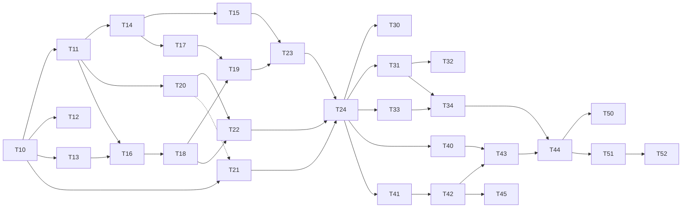

# Veky Companion — Plan de implementación por etapas (v1)

> Fecha: 2026-11-17. Diseño de referencia: `docs/02-diseno.md` (las secciones se citan como `02 §x`). Protocolo: `docs/01-orquestacion.md`.
> Cada tarea está escrita para que un orquestador la despache tal cual: un worker por tarea, worktree propio desde `origin/develop`, PR a `develop`.

## 0. Cómo leer este plan

- **Etapas:** cada una termina con algo que ella puede usar y con criterios de aceptación probados con ella.
- **Tareas:** `id`, dependencias (DAG), **ola** (tareas de la misma ola sin dependencias entre sí pueden correr en paralelo), modelo, archivos permitidos, entradas y evidencia de "hecho".
- **Modelos** (`01`): Sonnet medium para código con lógica o diseño de detalle; Haiku para trabajo mecánico con spec cerrado. Ninguna tarea toma decisiones de arquitectura: si una lo necesita, el worker escala.
- **Tareas del usuario** (`U#`): requieren a Gabriel o a ella; se indica la tarea más temprana que las necesita.
- **Reglas comunes a todas las tareas** (el orquestador las copia en cada spec):
  - No leer ni copiar `samples/`. No commitear secretos, fotos reales ni datos personales; los fixtures son inventados.
  - TypeScript estricto; `npm run typecheck` y `npm test` en verde en la raíz antes de pedir revisión.
  - Textos al usuario final en español rioplatense con "vos", tomados de `packages/core/src/copy/es-AR.ts`.
  - Commit con la línea de atribución del entorno. PR a `develop` solo con aprobación del orquestador.
  - Si la tarea contradice `02`, el worker escala en lugar de improvisar.

## 1. Resumen de etapas

| Etapa | Valor visible para ella | Tareas | Necesita del usuario |
|---|---|---|---|
| **E1 — "Le mando una foto y un audio y aparece en la web"** | Alta y edición de productos por voz y foto; catálogo público con botón de WhatsApp | T10–T24 | U1, U2, U3, U4, U5 (al final de E1) |
| **E2 — "Vendí dos y el bot me avisa de la feria"** | Stock por voz, agenda de ferias en la web, recordatorios y resumen semanal | T30–T34 | — |
| **E3 — "Me arma el flyer"** | Elige las mejores fotos, escribe el texto y entrega flyers listos para Instagram | T40–T45 | U6, U7, U8, U9 |
| **E4 — "Me arma el reel"** | Reels y carruseles con sus fotos y videos | T50–T52 | — |
| E5 — Publicación automática en Instagram (D7, fase 2) | El bot publica por ella | Sin desglosar | U10 |

## 2. Tareas del usuario

| Id | Qué | Quién | Necesaria para (lo más temprano) | Bloquea |
|---|---|---|---|---|
| U1 | Crear cuenta de Cloudflare (plan Free); crear D1 `veki`, R2 `veki-media`, colas `q-updates` y `q-jobs`; token R2 del bucket; anotar ids en `.env` del árbol principal | Gabriel | T24 (despliegue de E1). El desarrollo de T10–T23 es local | T24 |
| U2 | Crear el bot de producción con BotFather (Q2) y guardar `TELEGRAM_BOT_TOKEN` en `.env`; ella le manda `/start` | Gabriel + ella | T24 | T24 |
| U3 | Confirmar que ella usa Telegram (Q1); si no, instalarlo con ella | Gabriel + ella | Antes de empezar E1 (si la respuesta es "no", se replantea D1 antes de gastar trabajo) | Todo E1 |
| U4 | Decidir Q3 (número de WhatsApp público), Q4 (stock visible), Q6 (silencio), Q7 (categorías), Q8 (precios), Q10 (nombre del sitio) | Gabriel con ella | T21 puede usar valores de prueba; se necesitan reales en T24 | T24 |
| U5 | Conectar el repo a un proyecto de Cloudflare Pages (solo rama `main`), crear el deploy hook y pasar la URL a `.env` | Gabriel | T24 | T24 |
| U6 | Archivo del logo (SVG o PNG transparente, versiones positiva y negativa) en el árbol principal, fuera de git hasta decidir si se versiona | Gabriel | T41 (usa el wordmark de texto mientras tanto); necesario antes de cerrar E3 | Aceptación E3 |
| U7 | Sesión con ella con fotos reales de 5–10 productos | Gabriel + ella | Aceptación de E1 (cargar el catálogo inicial) y E3 (ajustar plantillas) | Aceptación E1, E3 |
| U8 | Aprobar el merge de `render.yml` a `main` (requisito de GitHub para disparar workflows) | Gabriel | T45 | T45 |
| U9 | Crear el fine-grained PAT (solo este repo, Actions: write) y guardarlo en `.env` | Gabriel | T45 | T45 |
| U10 | Convertir el Instagram a cuenta profesional (D7, `00` §7) | Ella + Gabriel | E5 | E5 |

## 3. Etapa 1 — "Le mando una foto y un audio y aparece en la web"

**Alcance:** monorepo, D1, webhook con colas, voz, agente con herramientas de catálogo, confirmación y deshacer, fotos en R2 con álbumes, API pública, sitio Astro con CTA de WhatsApp, reconstrucción automática, alertas y backups mínimos, despliegue.

**Criterios de aceptación (con ella, en su celular):**
1. Manda 1–5 fotos y un audio describiendo un producto; en ≤ 3 preguntas (una por vez) el bot muestra la vista previa con precio y nombre correctos.
2. Toca "Sí": el producto aparece en `https://<sitio>.pages.dev/p/<slug>/` en ≤ 30 min, con fotos, precio y botón de WhatsApp que abre un chat con ella con el mensaje prellenado.
3. Dice "cambiale el precio a quince mil" → vista previa → "Sí" → la web se actualiza. "Deshacé lo último" vuelve al precio anterior.
4. Toca "Sí" dos veces seguidas: un solo cambio en la base (`event_log` lo muestra una vez).
5. Un chat que no está en la allowlist no recibe respuesta.
6. Gabriel recibe el resumen diario y una alerta cuando se fuerza un error.
7. Existe un backup del día en R2 y `ops/RESTORE.md` se probó una vez contra una base local.

### T10 — Monorepo y herramientas base
- **Deps:** — · **Ola:** 1 · **Modelo:** Haiku (andamiaje mecánico con estructura dada).
- **Archivos:** `package.json`, `package-lock.json`, `tsconfig.base.json`, `vitest.workspace.ts`, `packages/core/{package.json,tsconfig.json,src/index.ts}`, `apps/{bot,web,render}/package.json` + `tsconfig.json` mínimos, `.gitignore` (agregar `.wrangler/`, `dist/`, `.astro/`).
- **Entradas:** `02 §7.1` (estructura), Node 22, npm workspaces, TypeScript `strict`, vitest. No tocar `spikes/`.
- **Hecho:** `npm ci && npm run typecheck && npm test` en verde en la raíz (con un test trivial por paquete); `git status` limpio tras el build.

### T11 — Esquema D1, migración inicial y tipos
- **Deps:** T10 · **Ola:** 2 · **Modelo:** Sonnet (traduce el modelo de datos a SQL + zod con invariantes).
- **Archivos:** `migrations/0001_init.sql`, `packages/core/src/db/{schema.ts,rows.ts,ids.ts}`, `apps/bot/wrangler.toml` (solo bindings D1/R2/Queues con ids de ejemplo y `database_id` vacío), `apps/bot/test/db.schema.test.ts`.
- **Entradas:** `02 §2.2` tal cual (tablas, índices, tipos), `02 §2.4`. ULID en `ids.ts`. Seed de `settings` con valores por defecto (`02 §2.2`, `§3.6`, `§4.6`, `§5.4`) en la misma migración.
- **Hecho:** `wrangler d1 migrations apply veki --local` OK; test que compara columnas de zod con `PRAGMA table_info` para cada tabla; salida de ambos en el PR.

### T12 — CI
- **Deps:** T10 · **Ola:** 2 · **Modelo:** Haiku (workflow estándar).
- **Archivos:** `.github/workflows/ci.yml`.
- **Entradas:** en `pull_request` a `develop` y `push` a `develop`: `npm ci`, `npm run typecheck`, `npm test`, `npm run build -w apps/web` (con fixture). `permissions: contents: read`. Sin secretos. Node 22 con cache npm. No tocar `render-spike.yml`.
- **Hecho:** link al run verde del PR.

### T13 — Proveedores: STT y chat
- **Deps:** T10 · **Ola:** 2 · **Modelo:** Sonnet (contratos, errores y reintentos).
- **Archivos:** `packages/core/src/providers/{types.ts,errors.ts,chain.ts,groq-stt.ts,workersai-stt.ts,groq-chat.ts,gemini-chat.ts,fakes.ts}`, tests en `packages/core/test/providers/`, `packages/core/scripts/measure-chat-tokens.ts`.
- **Entradas:** `02 §4.6` (interfaces, cadena, `ProviderError`, circuit breaker con `provider_state`, contadores `provider_usage`), `spikes/whisper/src/transcribe.ts` (llamada y lectura de headers de Groq), `spikes/vision/src/run.ts` (`withRetry`, sin `sleep` largos: devolver `retryAfterS` al llamador). Solo `fetch`, sin SDKs. `groq-chat` soporta `tools` y `response_format` JSON.
- **Hecho:** tests con `fetch` stubeado: 200, 429 con `retry-after`, 503, JSON inválido, fallback al segundo proveedor, cooldown. `measure-chat-tokens.ts` (corre manual con `.env`) imprime los tokens de entrada del system prompt + tools de T16 y los límites leídos de los headers de Groq para `gpt-oss-120b`; el resultado (solo números) va al PR. Resuelve el riesgo R3 o lo escala.

### T14 — Webhook, colas e idempotencia
- **Deps:** T11 · **Ola:** 3 · **Modelo:** Sonnet (camino crítico y seguridad).
- **Archivos:** `apps/bot/src/{index.ts,webhook.ts,queues.ts,env.ts}`, `apps/bot/wrangler.toml` (colas: `q-updates` con `max_batch_size=1`, `max_concurrency=1`; `q-jobs` con `max_concurrency=2`), `apps/bot/test/webhook.test.ts`.
- **Entradas:** `02 §1.3` pasos 2–3, `02 §3.5`, `02 §6.3` (secret header, allowlist, `allowed_updates`). Respuesta 200 siempre que el secret sea válido (incluido chat no permitido, para que Telegram no reintente). Router de consumidor: `type` del mensaje → handler (stubs por ahora).
- **Hecho:** tests con `@cloudflare/vitest-pool-workers`: secret inválido → 401 sin escritura; chat no permitido → 200, `event_log access.denied`, nada encolado; mismo `update_id` dos veces → un solo mensaje en cola; callback_query encolado.

### T15 — Simulador de updates
- **Deps:** T14 · **Ola:** 4 · **Modelo:** Haiku (porta casos existentes a fixtures).
- **Archivos:** `apps/bot/test/sim/{fixtures/*.json,stub-bot-api.ts,sim.test.ts}`.
- **Entradas:** casos de `spikes/telegram/src/sim.ts` (video, `document` video/mp4, > 20 MB, `video_note`, `animation`, sin tamaño + 400 "too big", álbum de videos, álbum mixto, texto, PDF) + voz, álbum de 3 fotos, callback `pa:<id>:yes`. El stub registra los métodos de la Bot API llamados (como el `transformer` del spike).
- **Hecho:** `npm test` corre el simulador; cada fixture tiene aserciones sobre las respuestas (texto por regex) y las filas creadas.

### T16 — Agente: ciclo, herramientas, borrador y textos
- **Deps:** T11, T13 · **Ola:** 3 · **Modelo:** Sonnet (núcleo conversacional).
- **Archivos:** `packages/core/src/tools/{defs.ts,index.ts}`, `packages/core/src/agent/{loop.ts,prompt.ts,draft.ts,state.ts}`, `packages/core/src/copy/es-AR.ts`, `apps/bot/src/handlers/{text.ts,voice.ts}`, tests.
- **Entradas:** `02 §3.1–3.4` completos (herramientas con schemas zod, `responder` como único canal, `nextMissingField`, tope de 4 llamadas, 12 turnos, malentendidos), `02 §3.2` (tono). Las herramientas de escritura llaman a `createPendingAction` (interfaz; implementación en T18). Voz: descarga de Telegram → `SttProvider` → mismo flujo que texto; nunca guardar el audio.
- **Hecho:** tests con `FakeChatProvider`: borrador que pide el campo que falta y solo uno; `responder` con dos `?` → regenera una vez; 4 llamadas sin salida → `copy.noEntendi`; voz con STT fake → mismo resultado que texto. System prompt + tools medido con T13 ≤ 2.500 tokens (número en el PR).

### T17 — Ingreso de fotos y videos, álbumes
- **Deps:** T14 · **Ola:** 4 · **Modelo:** Sonnet (concurrencia con D1 + colas).
- **Archivos:** `apps/bot/src/handlers/media.ts`, `apps/bot/src/jobs/album-flush.ts`, `apps/bot/src/r2.ts`, tests.
- **Entradas:** `02 §2.3` (algoritmo exacto), `02 §4.1`, `02 §2.5`. Descarga desde `getFile` a R2 `orig/YYYY/MM/<id>.<ext>`; dedupe por `tg_file_unique_id`. Al hacer flush, el álbum entra al agente como un evento `{media_ids}`.
- **Hecho:** test de integración: 3 fotos del mismo `media_group_id` en desorden → un solo evento al agente; 2 flush concurrentes → uno gana; foto reenviada → una sola fila `media`. Video > 20 MB → texto del spike.

### T18 — Acciones pendientes: confirmar, cambiar, cancelar, deshacer
- **Deps:** T16 · **Ola:** 4 · **Modelo:** Sonnet (idempotencia y consistencia).
- **Archivos:** `apps/bot/src/actions/{pending.ts,execute.ts,undo.ts}`, `apps/bot/src/handlers/callback.ts`, tests.
- **Entradas:** `02 §3.1` puntos 4–6, `02 §3.3` ("Cambiar", vencimiento 24 h). Cada ejecutor devuelve su `inverse`. Toda ejecución escribe `event_log` y marca `site_state.dirty_since` si cambia algo público.
- **Hecho:** tests: doble "Sí" → una ejecución; botón vencido → `copy.vencido`; "Cambiar" → nueva acción y la anterior `cancelled`; "Deshacer" restaura exactamente la fila anterior (comparación de snapshot).

### T19 — Herramientas de catálogo
- **Deps:** T17, T18 · **Ola:** 5 · **Modelo:** Sonnet (reglas de negocio).
- **Archivos:** `apps/bot/src/tools/catalog.ts`, `packages/core/src/catalog/{slug.ts,price.ts,search.ts}`, tests.
- **Entradas:** herramientas `buscar_productos`, `ver_producto`, `crear_producto`, `editar_producto`, `editar_variantes`, `agregar_fotos` de `02 §3.3`. Slug sin tildes y único (`-2`, `-3`). Formato de precio `$12.500`. Variante por defecto (`'' '' ''`) si no hay variantes.
- **Hecho:** tests unitarios de slug, precio y búsqueda (tildes, mayúsculas); integración: alta completa crea producto + variante + fotos `attached` con `position`.

### T20 — API pública y reconstrucción del sitio
- **Deps:** T11 · **Ola:** 3 · **Modelo:** Sonnet (contrato entre bot y web).
- **Archivos:** `apps/bot/src/public.ts`, `apps/bot/src/cron.ts` (solo la parte de rebuild y el esqueleto de los 2 crons), `packages/core/src/public/catalog-schema.ts`, `apps/web/src/fixtures/catalog.fixture.json`, tests.
- **Entradas:** `02 §5.3`, `02 §5.4`, `02 §3.7`. `GET /public/catalog.json` (solo `active`, sin stock numérico: estado de disponibilidad de `02 §5.1`; incluye `whatsapp_number` y ferias públicas futuras). `GET /public/media/:id` solo para fotos adjuntas a productos `active`; `Cache-Control` largo. Deploy hook vía `fetch` con tope diario.
- **Hecho:** tests: producto `hidden` no aparece; media de producto oculto → 404; cron con `dirty_since` y ventana cumplida → 1 llamada al hook; tope diario respetado. El fixture valida contra el schema.

### T21 — Sitio Astro
- **Deps:** T10 (usa el schema de T20 cuando esté; hasta entonces el fixture) · **Ola:** 2–4 (paralela) · **Modelo:** Sonnet (UI con marca, accesibilidad y build de imágenes).
- **Archivos:** `apps/web/**` (menos `src/fixtures/` que es de T20), `packages/core/src/wa.ts` + test.
- **Entradas:** `02 §5.1`, `§5.2`, `§5.3`; marca de `00` §13 (paleta, Poppins vía `@fontsource/poppins`); wordmark de texto "Veky" hasta U6. `CATALOG_URL` por variable de entorno del build; si falta, usa el fixture. Imágenes con `astro:assets` a WebP 400/800/1200. Sin frameworks de UI; JS mínimo.
- **Hecho:** `npm run build -w apps/web` con el fixture; Lighthouse móvil ≥ 90 en Performance y Accessibility (captura o JSON en el PR); test de `waLink` con tildes, ñ y `&`; el build falla si el fixture no valida.

### T22 — Operación: log, alertas, comandos de admin, backups
- **Deps:** T18, T20 · **Ola:** 5 · **Modelo:** Sonnet (varias piezas chicas con reglas de tasa).
- **Archivos:** `apps/bot/src/admin/{commands.ts,alerts.ts,digest.ts}`, `apps/bot/src/jobs/{backup.ts,purge.ts}`, `ops/RESTORE.md`, `ops/queries/*.sql`, tests.
- **Entradas:** `02 §6.1`, `§6.2`, `§6.4`, `§2.5`. Comandos `/estado`, `/log`, `/deshacer`, `/reconstruir`, `/pausa`, `/avisos` solo para `role=admin`. Alertas con tope 1 cada 30 min por tipo.
- **Hecho:** tests de comandos y de tope de alertas; backup genera JSON válido en R2 local; `ops/RESTORE.md` probado restaurando ese JSON en una D1 local nueva (comandos y salida en el PR).

### T23 — Escenarios de conversación de E1
- **Deps:** T19, T15 · **Ola:** 6 · **Modelo:** Sonnet (diseña guiones que prueban el flujo completo).
- **Archivos:** `apps/bot/test/scenarios/*.test.ts`, `apps/bot/scripts/eval-chat.ts`.
- **Entradas:** criterios de aceptación de E1 (1, 3, 4) como guiones con `FakeChatProvider`; `eval-chat.ts` corre los mismos con Groq real (manual, `.env`) e imprime herramientas elegidas por turno.
- **Hecho:** escenarios en verde en CI; salida de `eval-chat` (sin textos de ella, solo nombres de herramienta y si cumplió) en el PR.

### T24 — Despliegue de E1 y runbook
- **Deps:** T21, T22, T23, U1, U2, U4, U5 · **Ola:** 7 · **Modelo:** Haiku (pasos guiados) con Gabriel presente.
- **Archivos:** `ops/DEPLOY.md`, `apps/bot/scripts/set-webhook.ts`, `apps/bot/wrangler.toml` (ids reales no secretos), `ops/queries/seed-settings.sql`.
- **Entradas:** `02 §6.3` (lista de secretos, `wrangler secret put`), `setWebhook` con `secret_token`, `allowed_updates`, `drop_pending_updates`. Variable `CATALOG_URL` en Pages.
- **Hecho:** `wrangler deploy` OK; `getWebhookInfo` sin errores (salida sin token); un producto de prueba cargado desde el celular de Gabriel visible en la web; `wrangler tail` muestra el CPU de una invocación del consumidor (verifica R4 de `02 §8`: anotar el número); producto de prueba borrado.

**Olas de E1:** 1: T10 · 2: T11, T12, T13, T21 · 3: T14, T16, T20 · 4: T15, T17, T18 · 5: T19, T22 · 6: T23 · 7: T24.

## 4. Etapa 2 — "Vendí dos y el bot me avisa de la feria"

**Criterios de aceptación:**
1. "Vendí dos neceseres" con 2 variantes → el bot pregunta cuál con botones → vista previa → stock actualizado; la web muestra "Últimas unidades" o "Por encargo" según corresponda.
2. "El sábado estoy en la feria de Plaza X de 10 a 18" → vista previa → la feria aparece en `/agenda/` y en el inicio.
3. El día anterior a las 18:00 llega el aviso de feria; "Más tarde" lo pospone 3 h; nada llega entre 21 y 9 h.
4. El lunes a las 10:00 llega el resumen semanal con una sola sugerencia.
5. Tras 3 avisos ignorados del mismo tipo, ese tipo se pausa y Gabriel lo ve en su resumen.

### T30 — Stock por voz
- **Deps:** T24 · **Ola:** 8 · **Modelo:** Sonnet (desambiguación de variantes).
- **Archivos:** `apps/bot/src/tools/stock.ts`, tests, escenarios en `apps/bot/test/scenarios/stock.test.ts`.
- **Entradas:** `cambiar_stock` de `02 §3.3`; si hay > 1 variante candidata, `responder` con botones (≤ 6); stock nunca negativo (si quedaría negativo, la vista previa lo dice y fija 0).
- **Hecho:** escenarios: venta con 1 variante, con 2 variantes (pregunta), reposición, ajuste a 0; deshacer de una venta.

### T31 — Agenda de ferias (herramientas)
- **Deps:** T24 · **Ola:** 8 · **Modelo:** Sonnet (fechas relativas y zona horaria).
- **Archivos:** `apps/bot/src/tools/fairs.ts`, `packages/core/src/time/{argentina.ts,parse-relative.ts}`, tests.
- **Entradas:** `crear_feria`, `editar_feria`, `cancelar_feria`, `ver_agenda` de `02 §3.3`. El LLM devuelve fechas ISO; el código valida que estén en el futuro y en `America/Argentina/Buenos_Aires` (UTC-3 fijo). La vista previa muestra "sábado 22 de noviembre, de 10 a 18".
- **Hecho:** tests de formato y validación de fechas (cruce de medianoche, fin de mes); escenario "el sábado estoy en…".

### T32 — Agenda en la web
- **Deps:** T31 · **Ola:** 9 · **Modelo:** Haiku (página con datos ya definidos en el contrato).
- **Archivos:** `apps/web/src/pages/agenda/**`, componente de próxima feria en el inicio, fixture con ferias.
- **Entradas:** `02 §5.1` (ruta `/agenda/`); ferias de `catalog.json` (T20 ya las incluye).
- **Hecho:** build con fixture; feria pasada no aparece; link a mapa presente si hay `maps_url`.

### T33 — Motor de avisos (proactividad)
- **Deps:** T24 · **Ola:** 8 · **Modelo:** Sonnet (reglas de tiempo y prioridad).
- **Archivos:** `apps/bot/src/nudges/{engine.ts,rules.ts,quiet-hours.ts}`, `apps/bot/src/cron.ts` (parte de avisos), tests.
- **Entradas:** reglas de `02 §3.6` (silencio, 1 por día, prioridades, nunca dos sin respuesta, `ignored_streak`, posponer, conversación activa), `02 §3.7`. Funciones puras con `now` inyectado.
- **Hecho:** tabla de tests con fechas fijas que cubre cada regla; integración: cron con 2 avisos vencidos → sale solo el de mayor prioridad.
- **Requisito:** el motor de avisos de la etapa 2 debe leer la clave de `settings` `nudges_paused` (escrita por el comando de admin `/pausa`) y las claves `snooze:<tipo>` (escritas por `posponer_aviso`).

### T34 — Catálogo de avisos
- **Deps:** T31, T33 · **Ola:** 9 · **Modelo:** Sonnet (textos con tono + planificación).
- **Archivos:** `apps/bot/src/nudges/catalog/*.ts`, `packages/core/src/copy/es-AR.ts` (sección avisos), tests.
- **Entradas:** tabla de `02 §3.6` (sin `contenido_listo`, que es de E3). El botón "Te armo un flyer" de `feria_previa` responde "Eso llega pronto 😊" hasta E3.
- **Hecho:** tests de planificación (feria creada → 2 avisos programados; feria cancelada → avisos cancelados); capturas o texto de cada mensaje en el PR.

**Olas de E2:** 8: T30, T31, T33 · 9: T32, T34.

## 5. Etapa 3 — "Me arma el flyer"

**Criterios de aceptación:**
1. "Haceme un flyer de la riñonera girasol" → "Estoy mirando tus fotos 👀" → las 3 mejores con botones 1/2/3 → texto propuesto con nombre y precio exactos → "Sí" → en ≤ 5 min recibe el flyer feed, el story y el texto para copiar.
2. Con Gemini caído (forzado en `settings`), el flujo termina igual con Groq y Gabriel ve el fallback en el log.
3. El aviso `feria_previa` lleva a un flyer de feria con fecha y lugar correctos.
4. Ninguna URL prefirmada ni foto aparece en los logs públicos del run de Actions.
5. Ella sube un flyer a Instagram siguiendo la guía, sin ayuda.

### T40 — Visión: ranking y atributos
- **Deps:** T24 · **Ola:** 8 · **Modelo:** Sonnet (asincronía con reintentos por cola).
- **Archivos:** `packages/core/src/providers/{gemini-vision.ts,groq-vision.ts}`, `apps/bot/src/jobs/vision.ts`, tests.
- **Entradas:** `02 §4.2` (reintentos por `message.retry`, cooldown, 3 imágenes en Groq), prompts y schemas de `spikes/vision/src/run.ts`. Usa `tg_small_file_id` (`02 §4.1`).
- **Hecho:** tests con fetch stubeado: 503 ×3 → cambia a Groq; 429 con `retry-after` → `retry({delaySeconds})` correcto; > 3 imágenes en Groq → recorte y evento `vision.degraded`; resultado guardado en `content_jobs`.

### T41 — CLI de render: plantillas de flyer
- **Deps:** T24 (marca en core) · **Ola:** 8 · **Modelo:** Sonnet (layout con Satori).
- **Archivos:** `apps/render/src/{render-job.ts,flyer/*.tsx|ts,brand.ts→re-export de core}`, `apps/render/test/*`, `packages/core/src/brand.ts`, `packages/core/src/render/job-spec.ts` (schema zod del spec).
- **Entradas:** `02 §4.4` (plantillas `producto`, `feria`, `novedad`; feed y story), `spikes/render/src/flyer.ts` y `deps.ts` como base. `render-job.ts --spec spec.json --out dir` lee entradas por URL o archivo local. Logo de U6 si existe, si no wordmark.
- **Hecho:** test genera las 6 imágenes con entradas sintéticas y verifica dimensiones; PNGs de ejemplo **sintéticos** adjuntos como imágenes en el PR (no commiteados).

### T42 — Workflow de render, OIDC y URLs prefirmadas
- **Deps:** T41 · **Ola:** 9 · **Modelo:** Sonnet (seguridad).
- **Archivos:** `.github/workflows/render.yml`, `apps/bot/src/render/{dispatch.ts,oidc.ts,presign.ts,routes.ts}`, tests.
- **Entradas:** `02 §4.4` pasos 1–6 y `02 §9` punto 1 (`workflow_dispatch`, PAT con Actions: write). ffmpeg estático cacheado con `actions/cache`. `permissions: {id-token: write, contents: read}`. Sin `upload-artifact`. Medir CPU de la verificación OIDC (R5).
- **Hecho:** tests de `oidc.ts` con JWT y JWKS generados en el test (firma válida, `aud` incorrecto, `workflow_ref` de otra rama, vencido); test de `presign.ts`; `actionlint` sin errores; el workflow corre con `workflow_dispatch` manual en la rama de la tarea contra un Worker local expuesto **o**, si no es posible, se documenta que la prueba de punta a punta queda para T45.

### T43 — Textos y máquina de estados del contenido
- **Deps:** T40, T42 · **Ola:** 10 · **Modelo:** Sonnet (orquesta el flujo completo).
- **Archivos:** `apps/bot/src/content/{jobs.ts,copy.ts,deliver.ts}`, `packages/core/src/copy/es-AR.ts` (sección contenido), tests.
- **Entradas:** `02 §4.3` (datos confirmados obligatorios, validación de nombre y precio), estados de `content_jobs` (`02 §2.2`), entrega de `02 §4.5`, timeouts del cron (`02 §3.7`).
- **Hecho:** test de punta a punta con proveedores y dispatch fake: `ranking → awaiting_choice → writing → awaiting_copy_ok → rendering → delivering → delivered`; epígrafe sin precio → regenera; timeout → reintento y luego `failed` con mensajes a ella y a Gabriel.

### T44 — Herramienta `pedir_contenido` y aviso de feria
- **Deps:** T43, T34 · **Ola:** 11 · **Modelo:** Sonnet (integra agente y avisos).
- **Archivos:** `apps/bot/src/tools/content.ts`, `apps/bot/src/nudges/catalog/feria-previa.ts`, escenarios.
- **Entradas:** `pedir_contenido` de `02 §3.3`; `feria_previa` "Sí, dale" crea un job `flyer/feria`.
- **Hecho:** escenarios "haceme un flyer de X" y "aviso de feria → flyer" en verde.

### T45 — Prueba real del disparo y medición
- **Deps:** T42, U8, U9 · **Ola:** 10–11 · **Modelo:** Haiku (ejecutar y medir con pasos dados).
- **Archivos:** `ops/RENDER.md`.
- **Entradas:** `render.yml` ya en `main` (U8); PAT (U9) como `wrangler secret`. 5 disparos desde el Worker desplegado con entradas sintéticas.
- **Hecho:** tabla en `ops/RENDER.md` con latencia API → inicio del job → `done` (min/mediana/máx) y confirmación de que los logs del run no muestran URLs (link a los runs).

**Olas de E3:** 8: T40, T41 · 9: T42 · 10: T43, T45 · 11: T44.

## 6. Etapa 4 — "Me arma el reel"

**Criterios de aceptación:**
1. Manda 3 fotos y 1 video corto y pide un reel → recibe un MP4 9:16 de 15–30 s con textos y placa final, que pasa `ffprobe` contra la spec de Reels.
2. Pide un carrusel de 3 productos → recibe 5 placas (portada, 3 productos, cierre) y el texto.

### T50 — Plantilla de carrusel
- **Deps:** T44 · **Ola:** 12 · **Modelo:** Haiku (reusa componentes de flyer de T41).
- **Archivos:** `apps/render/src/carousel/*`, tests.
- **Entradas:** `02 §4.4` fila `carrusel`.
- **Hecho:** test genera 5 PNG 1080×1350 con entradas sintéticas.

### T51 — Plantilla de reel con medios reales
- **Deps:** T44 · **Ola:** 12 · **Modelo:** Sonnet (ffmpeg con entradas variables).
- **Archivos:** `apps/render/src/reel/*`, tests.
- **Entradas:** `spikes/render/src/reel.ts` como base; textos del job en lugar de la lista fija; normalizar orientación y tamaño de fotos y clips reales (videos del celular, `02 §4.1`); duración objetivo 15–30 s.
- **Hecho:** test sintético con fotos verticales, horizontales y un clip; validación `ffprobe` (como el spike) en CI; tiempo de render anotado.

### T52 — Reels y carruseles en el flujo
- **Deps:** T50, T51 · **Ola:** 13 · **Modelo:** Sonnet.
- **Archivos:** `apps/bot/src/content/*`, `apps/bot/src/tools/content.ts`, escenarios.
- **Entradas:** `pedir_contenido` con `tipo: reel|carrusel`; videos `inbox` del producto como clips; `sendVideo` ≤ 50 MB.
- **Hecho:** escenarios en verde; una entrega real a Gabriel (sin fotos de ella en el PR).

## 7. Etapa 5 (sin desglosar) — Instagram por API

Requiere U10 y una decisión del usuario sobre automatizar publicaciones. Piezas conocidas (`00` §7): login de Instagram, token de 60 días renovado por cron, publicación de imagen y reel desde URL pública (R2 prefirmado). Se planifica cuando E4 esté en uso.

## 8. Mapa de paralelismo (olas)

| Ola | Tareas en paralelo |
|---|---|
| 1 | T10 |
| 2 | T11, T12, T13, T21 |
| 3 | T14, T16, T20 (T21 sigue) |
| 4 | T15, T17, T18 |
| 5 | T19, T22 |
| 6 | T23 |
| 7 | T24 (con Gabriel) |
| 8 | T30, T31, T33, T40, T41 (E2 y el inicio de E3 pueden correr juntas) |
| 9 | T32, T34, T42 |
| 10 | T43, T45 |
| 11 | T44 |
| 12 | T50, T51 |
| 13 | T52 |

Conflictos de archivos a vigilar por el orquestador: `packages/core/src/copy/es-AR.ts` (T16, T34, T43: cada una agrega su propia sección; mergear en orden), `apps/bot/src/cron.ts` (T20, T33), `apps/bot/wrangler.toml` (T11, T14, T24).

## 9. Backlog: módulos pedidos, sin desglosar

### Calculadora de precios (pedido del autor el 2026-11-17, va al final)

Ayuda a calcular cuánto cobrar por un producto. Boceto de alcance, a diseñar después de la etapa 4:
- Entradas conversacionales: materiales y su costo, tiempo de trabajo, costos de feria (puesto, traslado, comisiones), margen deseado.
- Guarda un catálogo de materiales y costos reutilizable, para que la próxima vez solo diga "hice otro neceser igual".
- Devuelve un precio sugerido con el desglose y la pregunta de confirmación; nada se guarda en el producto sin "Sí" (como el resto de las escrituras).
- Preguntas a resolver con ella antes de diseñar: cómo valora hoy su tiempo, si prefiere precios redondeados, si quiere precio por mayor.
- Depende de: el catálogo (E1) y la herramienta de edición de productos. Candidato natural a etapa 6.
